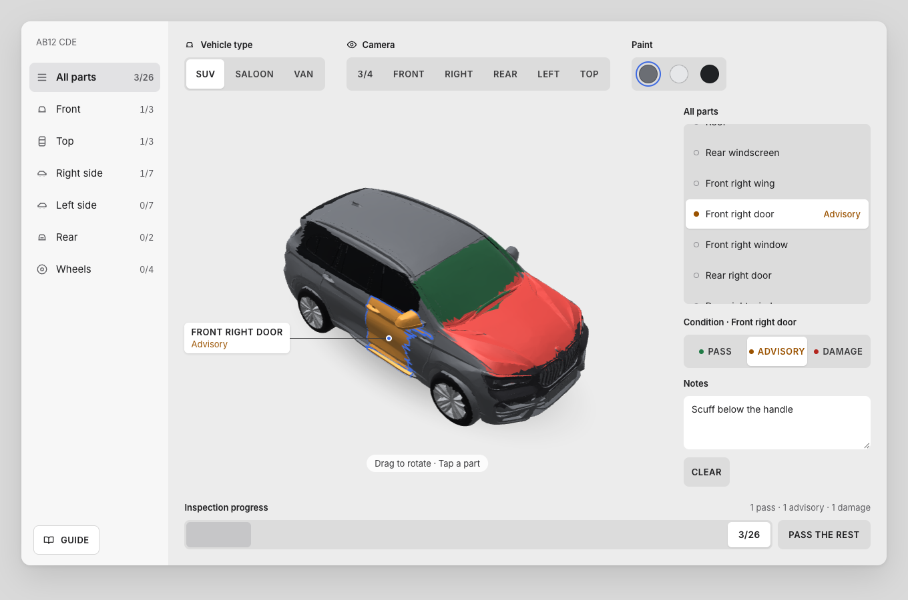
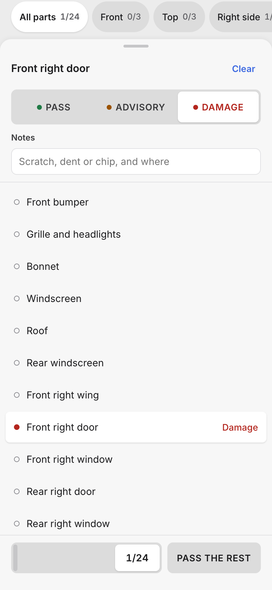

# 3D Car Parts Selector

An interactive vehicle-inspection demo. Rotate a 3D car, tap any body panel, window or wheel,
and mark it **Pass**, **Advisory** or **Damage** with a note. Built with React, three.js and
React Three Fiber.

**Live demo: https://car-parts-selector.bubbablaise3.workers.dev**



<p align="center">
  
</p>

## Features

- **Tap parts on the car.** There are 24–26 selectable parts per vehicle: bumpers, grille and
  lights, bonnet, windscreens, roof, wings, doors, windows, quarter panels, boot or rear doors,
  and wheels. A blue outline and a callout show the selected part.
- **Record the inspection.** Mark Pass, Advisory or Damage, add notes, and clear a part. The
  car is tinted to match each condition.
- **Three real vehicles.** An SUV (BMW X1), a saloon (Mercedes-Benz S-Class W222) and a van,
  each split into inspection parts automatically.
- **Navigate quickly.** Zone filters (Front, Top, sides, Rear, Wheels) show a checked count, and
  there are six camera presets plus drag-to-rotate. "Pass the rest" marks every unchecked part
  as Pass.
- **Desktop and phone layouts.** On phones the layout follows the mobile design, with zone pills
  and a parts sheet whose footer stays pinned to the bottom of the screen.
- **Accessible.** The whole inspection works with a keyboard, screen readers announce each
  selection, touch targets are at least 44 px, and the reduced-motion setting is respected.
- **Resilient.**
  - Without WebGL, the full inspection still works from the list.
  - If the GPU context is lost, the 3D view rebuilds itself.
  - If a model fails to load, a drawn stand-in shape is shown instead.
- **Fast.** The initial JavaScript is about 74 KB gzipped, and the 3D code loads afterwards.
  Each frame takes 2–3 draw calls, and nothing renders while the scene is idle.

It's a demo, so **nothing is saved**: reloading the page starts a fresh inspection.

## Tech stack

| Area | Choice |
|------|--------|
| App | React 19, TypeScript (strict), Vite 8 |
| 3D | three.js, React Three Fiber, drei `CameraControls`, three-mesh-bvh (fast picking) |
| State | zustand, in memory only |
| Models | GLB with Meshopt compression, built by `scripts/build-model.mjs` (gltf-transform, meshoptimizer) |
| Tests | Vitest and Testing Library (unit and component), Playwright (end-to-end in Chromium and WebKit) |
| Hosting | Cloudflare Workers static assets (`wrangler.jsonc`) |

## Getting started

You need Node 22 or newer.

```bash
npm ci
npm run dev          # http://localhost:5173
```

## Scripts

| Command | What it does |
|---------|--------------|
| `npm run dev` | Start the Vite dev server |
| `npm run build` | Type-check and build to `dist/` |
| `npm run preview` | Serve the production build |
| `npm run typecheck` | Run strict TypeScript checks |
| `npm run lint` | Run ESLint (typescript-eslint, react-hooks, jsx-a11y) |
| `npm test` | Run the Vitest unit and component tests |
| `npm run test:e2e` | Run the Playwright tests against a production build. The first time, run `npx playwright install chromium webkit firefox` |
| `npm run size` | Fail if the initial JavaScript exceeds 300 KB gzipped (run after `build`) |
| `npm run deploy` | Build and deploy to Cloudflare |

## Project structure

```text
src/
├── vehicles/   Pure data and geometry, with no React and no three.js
│   ├── catalog.ts            Body styles, zones, paints
│   ├── parts.ts              Inspection parts for each body style
│   ├── modelSegmentation.ts  Splits each real model into parts (per-vehicle rules)
│   └── geometry.ts           Drawn stand-in shapes, used if a model fails to load
├── state/      zustand store, selectors, types
├── scene/      Lazy-loaded 3D code: canvas, mesh, picking, camera, callout
├── ui/         Accessible DOM components, plus the desktop and phone layouts
└── styles/     Design tokens and layout CSS
scripts/        build-model.mjs (STL, OBJ or GLB in, compressed GLB out), check-size.mjs
public/models/  suv.glb, saloon.glb, van.glb
specs/          Spec Kit specification, plan, tasks and design notes
tests/          unit/, component/, e2e/
```

## 3D models

The source models have no separate panels, so `src/vehicles/modelSegmentation.ts` assigns each
triangle to an inspection part. It works from landmarks measured on each model (door lines,
belt line, wheel centres), plus the source file's object and material names where it has them
(wheels, doors, glass). Unit tests check that every part is covered and sits in the right place.

To rebuild a model after changing its source file:

```bash
node scripts/build-model.mjs ~/Downloads/bmwx1f48.stl public/models/suv.glb 150000 4.5
node scripts/build-model.mjs ~/Downloads/ImageToStl.com_MB.W222.AMG.glb public/models/saloon.glb 150000 5.0
node scripts/build-model.mjs "$HOME/Downloads/Van_Car_1/Van Car 1/Van Car 1.obj" public/models/van.glb 150000 4.7
```

If a rebuilt model changes shape, re-measure its landmarks in `modelSegmentation.ts`.

## Testing

```bash
npm run typecheck && npm run lint && npm test
npm run test:e2e
```

The end-to-end tests cover:
- picking parts on the car, and how accurately taps land
- conditions and notes
- zones and camera presets
- switching vehicle
- keyboard-only use
- the no-WebGL fallback
- recovery from a lost GPU context
- reduced motion
- the phone layout
- load time (Chromium only)

GitHub Actions runs the checks and the Chromium end-to-end tests on every push and pull
request.

## Deployment

The app is hosted on **Cloudflare** as a Workers static-assets site:

```bash
npm run deploy   # needs `npx wrangler login` once
```

## Specification

The feature was built with [Spec Kit](https://github.com/github/spec-kit). The spec, plan,
research, data model, UI contract, tasks and performance notes are in
[`specs/001-car-parts-selector/`](specs/001-car-parts-selector/). The project's principles are
in [`.specify/memory/constitution.md`](.specify/memory/constitution.md).

## Credits and licences

- **Font:** Inter, by Rasmus Andersson, under the SIL Open Font License 1.1.
- **3D models:** the SUV, saloon and van models were supplied by the project owner. Their
  original sources and licences are still being confirmed; see
  [`public/LICENSES.md`](public/LICENSES.md).
- **Trademarks:** "BMW", "X1", "Mercedes-Benz" and "S-Class" are trademarks of their owners.
  This is an independent demo, not affiliated with or endorsed by either company.
